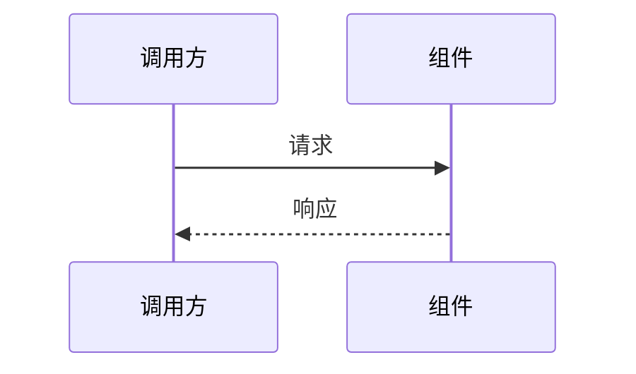

# 研发全流程

> **把系统做成什么样——需求文档回答；怎么实现——架构文档回答。**
> 基础约定（文档命名、反模式）参见 `development.instructions.md`。

适用于新建应用系统、新增功能模块、需求整理、架构设计等研发全流程任务。

---

## 0. 功能模块编码方案

采用 **字母前缀 + 数字后缀** 的编码体系，解决纯数字 Mx- 方案新增模块需全局重编号的问题。

### 0.1 格式

```
{MOD}-{N}[{letter}]
```

| 段 | 含义 | 示例 | 说明 |
|----|------|------|------|
| `MOD` | 模块字母缩写 | `SYS`, `NET` | 2~4 个大写字母，必须具有助记性 |
| `N` | 模块内功能序号 | `1`, `2` | 从 1 开始，支持 1~N |
| `letter` | 子功能标识（可选） | `a`, `b` | 功能粒度不够时用小写字母细分 |

### 0.2 示例

- `SYS-1` — 系统基础-部署与守护
- `SYS-1a` — 系统基础-部署与守护-StarAgent 守护配置
- `NET-3` — 网络接入-DHCP 服务
- `NET-3a` — 网络接入-DHCP 服务-地址池 CRUD API

### 0.3 复杂模块（三级格式）

子项过多时（>15 个），允许降级到三级：`NET-5-1a`（网络接入-dnsmasq 集成-配置生成）

### 0.4 存量兼容

- 已有 Mx- 编码的项目：存量模块保留 M1/M2/M3，新增模块可用新编码
- 两种方案可在同一文档混用
- 新项目默认使用字母前缀方案

### 0.5 常见编码映射

| 模块 | 推荐编码 | 说明 |
|------|----------|------|
| 系统基础 | `SYS` | System |
| 认证权限 | `AUTH` | Authentication |
| 网络接入 | `NET` | Network |
| 安全管控 | `SEC` | Security |
| 终端管理 | `DEV` | Device |
| 路由/VPN | `RT` | Route |
| 数据统计 | `STAT` | Statistics |
| 系统运维 | `OPS` | Operations |

---

## 1. 核心理念

```
一句话愿景 → 需求文档（WHAT）→ 功能清单（追踪+任务管理）→ 架构文档（HOW）→ 迭代开发 → 测试
```

- **需求文档 = WHAT**：定义系统长什么样、有哪些模块、每个模块做什么、不做什么、暂缓什么
- **架构文档 = HOW**：定义每个模块怎么实现——组件、流程、时序、关键决策
- **功能清单独立维护**：完成状态在 `功能清单.md` 追踪，不混入需求文档
- **README.md = 门面**：项目根目录的入口文档——项目简介 + 亮点 + 文档索引，与需求文档的愿景/核心目标保持一致
- **竞品分析 = WHY NOT**：竞品分析报告是需求的第二来源，提供功能遴选依据，详见 [competitive-analysis](../competitive-analysis/SKILL.md) 技能
- **大需求必须拆小**：功能点 > 5 / 实体 > 3 / 跨 2 层以上 → 先拆分再开发
- **方案深度匹配问题复杂度**：简单需求用简单方案，复杂需求用完整架构。不要在简单 CRUD 上堆砌设计模式，也不要在复杂系统上走捷径
- **AI 是技术思考伙伴**：在需求整理和架构设计阶段，AI 主动提出不同方案对比，而非被动记录用户想法

---

## 2. 各阶段规范

### 2.1 需求整理（WHAT）

用户提供原始描述，AI 整理为 `Doc/需求文档.md`。需求文档只回答"系统做成什么样"，不涉及实现细节。

AI 在整理过程中承担**技术思考伙伴**角色：
- 先评估需求复杂度，确定需要多深度的方案
- 对模糊不清的需求点主动提问（"这里有几个选项..."、"是否需要考虑..."）
- 当用户表述带犹豫信号时，先做方案对比再写入文档
- 标注需要进一步确认的决策点

```markdown
# {项目名}需求文档

> 版本：v1.0 | 日期：{日期}

本文档描述 {项目名} 的愿景、核心目标和功能方向。完成状态在[功能清单](功能清单.md)中追踪，详细设计在[架构设计](架构设计.md)或各模块架构文档中展开。

## 1. 背景与愿景

### 1.1 系统定位
一句话说清楚这是什么系统、给谁用、解决什么问题。可以补充一个简表说明各产品/工程的定位差异。

### 1.2 愿景
系统做成了会是什么样子——越用越聪明、多入口统一服务、具备领域深度等。

## 2. 核心目标

先用一张表说清整体目标体系：

| 编号 | 目标 | 所属层级 | 一句话描述 |
|------|------|----------|------------|
| SYS | 系统基础 | 基础层 | {一句话描述系统基础设施} |
| NET | 网络接入 | 核心层 | {一句话描述网络能力} |

> 编码说明：新项目推荐字母前缀方案（SYS/NET），存量 Mx- 项目可继续使用 M1/M2。

## 3. 功能需求

按目标组织，每个目标下列出功能点。每个功能点一句话描述，不展开验收条件。

### 3.1 SYS — 系统基础

- **SYS-1 {功能名}**：一句话描述该功能做什么。
- **SYS-2 {功能名}**：一句话描述。

### 3.2 NET — 网络接入

- **NET-1 {功能名}**：一句话描述。

> 编码说明：新项目推荐字母前缀方案，存量 Mx- 项目可继续使用 M1/M2/M3 编码。

...（其他目标）

## N. 🧊 暂缓清单

计划做但现在不做，注明显式理由和可重新评估的前提。

| 功能 | 暂缓理由 | 解冻前提 |
|------|----------|----------|
| {功能名} | {为什么现在不做} | {什么条件满足后可做} |

## N+1. 不做什么

明确排除的功能项，避免后续争议。

- {排除项}：{理由}
```

**规则**：
- **编码方案**（二选一，按项目阶段选择）：
  - **旧方案 Mx- 风格**（存量项目沿用）：模块用 `M1/M2/M3`，子功能用 `M1-1/M1-2/M2-1`，子子功能用 `M1-1a/M1-1b`
  - **新方案 字母前缀风格**（新项目推荐）：模块用 2~4 个大写字母缩写（如 `SYS`/`NET`/`AUTH`），功能用 `SYS-1/SYS-2`，子功能用 `SYS-1a/SYS-1b`
- 两种方案可在同一项目混用：存量模块保持 Mx-，新增模块用字母前缀
- 极少数复杂模块（子项 >15 个）可降级到三级格式 `NET-5-1a`
- 核心目标表先总览后展开，功能需求按目标分组
- 每个子功能一句话描述，不展开验收条件、优先级、用户故事
- 非功能需求不单独列章（团队默认追求最高性能和安全）
- 不写术语表、边界与约束章节

### 2.1.5 拆分检查点（强制步骤）

> ⛔ **强制规则**：从需求文档生成功能清单前，**必须**对每个需求项执行拆分检查。跳过此步骤直接生成功能清单，是彩虹桥项目失败的直接原因。

#### 拆分决策流程

对需求文档第 3 章中的每个功能点，逐项回答以下 3 个问题：

1. **有后端 API？** → 是否需要服务端接口/服务/守护进程？
2. **有前端 UI？** → 是否需要页面/界面/可视化展示？
3. **多平台实现不同？** → Linux/Windows/macOS 等是否有不同的实现路径？

根据回答生成**拆分决策表**，该表是功能清单的直接输入：

```markdown
| 需求项 | 原因 | 拆分结果 |
|--------|:----:|---------|
| WAN口管理 | 前后端 | NET-1a WAN管理接口 + NET-1b WAN管理页面 |
| 防火墙规则 | 前后端+多平台 | SEC-1a 防火墙接口 + SEC-1b 防火墙页面 + SEC-1c 防火墙规则(Linux) + SEC-1d 防火墙规则(Windows) |
| 系统监控 | 多平台 | OPS-1a 系统监控(Linux) + OPS-1b 系统监控(Windows) |
```

> 不拆分项不写入决策表——没列出的就是单一功能点。去掉四列表格和"不拆分"标注，避免噪音行淹没有效拆分信息。

#### 默认拆分规则

| 项目类型 | 默认行为 |
|----------|---------|
| **Web 管理后台**（Cube / SPA / Blazor 等） | 每个需求项**默认**前后端拆分，除非需求文档明确标注"仅后端"/"仅前端" |
| **纯 API 服务**（无前端） | 不拆分前后端；多平台仍按平台拆分 |
| **跨平台工具/服务** | 评估是否有平台特定实现，有则按平台拆分 |

> 判断依据：读取项目 `README.md`、`Doc/架构设计.md` 或 `.csproj` 引用（是否含 `NewLife.Cube`、前端框架等）来确定项目类型。

#### 拆分决策表输出要求

- 拆分决策表**必须写入 `Doc/功能清单.md`**（作为文件开头或独立小节）
- **仅列出实际发生拆分的行**，不拆分项不写入决策表。表头简化为 `需求项 | 原因 | 拆分结果`，原因列标注"前后端"或"多平台"。未列出的需求项即为单一功能点，无需额外说明——决策表的本质是记录拆分决策，没拆的谈不上"决策"
- 功能清单直接使用拆分后的编码（如 `NET-1a`、`NET-1b`），不再保留未拆分的原始编码
- 拆分后每个子功能点的命名遵循 [§4.2 命名约定](#42-功能点命名约定)

#### ⚠️ 真实教训 — 彩虹桥软路由项目

> 彩虹桥项目需求文档质量优秀，但因**未执行拆分检查**，"WAN口管理""DHCP配置""防火墙规则"等均作为单一功能点列入清单。
> AI 实现后端 API 后逐一标记 ✅ 完成——实际上 90% 的管理页面缺失，系统完全不可用。
> **根因**：拆分发生在开发者脑子里，没写在文档里，AI 拿到的是未拆分的清单，无法判断一个功能点是否需要前端。
> **教训**：每一个涉及用户交互的功能，必须在功能清单中拆为「接口」+「页面」两个独立项。本检查点就是为了防止此类问题再次发生。

### 2.2 功能清单（追踪）

独立文件 `Doc/功能清单.md`，维护每个子功能的**实现、测试、注释**三维完成状态。采用拆分后的模板（§4.4 拆分后模板），每个功能点标注**类型**（后端/前端/服务/适配器），并按父需求分组展示。

```markdown
# {项目名}功能清单

> 版本：v1.0 | 日期：{日期}

> 状态标记：✅ 已完成 | 🟡 部分完成 | 🔧 规划中 | ⏸ 暂缓/占位 | ❌ 未开始 | ❓ 待确认 | — 不适用

**拆分规则**：前后端拆为独立功能点，多平台拆为独立功能点。每个功能点保持 3 维状态（实现/测试/注释）。

## SYS 系统基础

### 父需求：部署与守护

| 编码 | 功能 | 类型 | 实现 | 测试 | 注释 | 说明 |
|------|------|:----:|:----:|:----:|:----:|------|
| SYS-1a | StarAgent 守护配置 | 后端 | 🟡 | ❌ | ✅ | 缺崩溃重启测试 |
| SYS-1b | 健康检查端点 | 后端 | ✅ | ✅ | ✅ | |
| SYS-1c | 发行版检测 | 后端 | ✅ | ❌ | ✅ | 缺测试 |

> 父需求状态：🟡（SYS-1a 缺测试，SYS-1c 缺测试）

### 父需求：双入口架构

| 编码 | 功能 | 类型 | 实现 | 测试 | 注释 | 说明 |
|------|------|:----:|:----:|:----:|:----:|------|
| SYS-2a | React SPA 初始化 | 前端 | ✅ | ✅ | ✅ | |
| SYS-2b | SPA 路由回退 | 后端 | ✅ | ✅ | ✅ | |
| SYS-2c | Cube /admin 入口 | 后端 | ✅ | ✅ | ✅ | |

> 父需求状态：✅（所有子项均完成）

## NET 网络接入

### 父需求：WAN口管理

| 编码 | 功能 | 类型 | 实现 | 测试 | 注释 | 说明 |
|------|------|:----:|:----:|:----:|:----:|------|
| NET-1a | WAN管理接口 | 后端 | ❌ | — | — | 待开发 |
| NET-1b | WAN管理页面 | 前端 | ❌ | — | — | 待开发 |

> 父需求状态：❌（所有子项均未开始）

## 统计

### 子功能统计

| 模块 | 标识 | 功能点数 | 实现完成 | 测试通过 | 注释覆盖 | 综合完成率 |
|------|------|:-------:|:--------:|:--------:|:--------:|:---------:|
| 系统基础 | SYS | 5 | 4 | 3 | 5 | 60% |
| 网络接入 | NET | 2 | 0 | 0 | 0 | 0% |
| **总计** | **2** | **7** | **4** | **3** | **5** | **43%** |

### 父需求完成度

| 父需求 | 子项数 | 已完成 | 状态 | 说明 |
|--------|:-----:|:-----:|:----:|------|
| 部署与守护 | 3 | 1/3 | 🟡 | 缺测试 |
| 双入口架构 | 3 | 3/3 | ✅ | 全部完成 |
| WAN口管理 | 2 | 0/2 | ❌ | 全部待开发 |

> **父需求状态判定**：所有子项三列均为 ✅ → ✅；任一子项非 ✅ → 🟡；所有子项均为 ❌ → ❌。
> 父需求完成度是**功能真正可用的唯一指标**。子功能统计可能显示"50%完成"，但父需求维度揭示实际可用比例为 0%。
```

**三列状态说明**：

| 列 | 含义 | 判断标准 |
|----|------|----------|
| **实现** | 功能代码是否完整 | ✅ 所有场景已实现；🟡 部分场景实现；❌ 未实现 |
| **测试** | 是否有测试且通过 | ✅ 核心场景 + ≥1 边界 + ≥1 异常均通过；🟡 仅有 happy path 测试；❌ 无测试或测试失败；— 不适用 |
| **注释** | public API 注释完整性 | ✅ `<summary>`+`<param>`+`<returns>` 齐全；🟡 部分缺失；❌ 无注释；— 不适用（非 public API） |

**规则**：
- 子功能在实现中可进一步拆分（如 SYS-3 → SYS-3a / SYS-3b 或 M1-3 → M1-3a / M1-3b），用子编码追踪
- 统计表每模块一行 + 总计行，自动计算各维度数量与综合完成率
- 综合完成率 = 实现完成且测试通过且注释覆盖的功能数 / 总功能数
- 状态变更时同步更新三列，保持与代码实际进度一致
- 状态标记 `⏸` 表示暂缓或占位，与需求文档 🧊 暂缓清单对应
- 状态标记 `❓` 表示待人工确认（用于 doc-sync agent 发现的不确定项）
- **小型项目**（<10 功能点）可仅保留实现列，大型项目推荐三列完整追踪
- **父需求完成度是功能可用性的唯一指标**，不可用子功能统计替代；统计报告中必须同时展示子功能统计和父需求完成度

**三列状态说明**：

| 列 | 含义 | 判断标准 |
|----|------|----------|
| **实现** | 功能代码是否完整 | ✅ 所有场景已实现；🟡 部分场景实现；❌ 未实现 |
| **测试** | 是否有测试且通过 | ✅ 核心场景 + ≥1 边界 + ≥1 异常均通过；🟡 仅有 happy path 测试；❌ 无测试或测试失败；— 不适用 |
| **注释** | public API 注释完整性 | ✅ `<summary>`+`<param>`+`<returns>` 齐全；🟡 部分缺失；❌ 无注释；— 不适用（非 public API） |

**规则**：
- 子功能在实现中可进一步拆分（如 SYS-3 → SYS-3a / SYS-3b 或 M1-3 → M1-3a / M1-3b），用子编码追踪
- 统计表每模块一行 + 总计行，自动计算各维度数量与综合完成率
- 综合完成率 = 实现完成且测试通过且注释覆盖的功能数 / 总功能数
- 状态变更时同步更新三列，保持与代码实际进度一致
- 状态标记 `⏸` 表示暂缓或占位，与需求文档 🧊 暂缓清单对应
- 状态标记 `❓` 表示待人工确认（用于 doc-sync agent 发现的不确定项）
- **小型项目**（<10 功能点）可仅保留实现列，大型项目推荐三列完整追踪

### 2.3 架构设计（HOW）

架构文档只回答"怎么实现"，不重复需求文档中的功能描述。**架构设计不是每个功能都必须经过的步骤**——仅对复杂功能展开。

- **简单功能**（单一 CRUD、无多平台、无复杂流程）：跳过架构设计，直接从功能清单进入迭代开发。拆分决策表（§2.1.5）已包含足够的架构判断。
- **复杂功能**（>5 实体 / 跨服务 / 多平台 / 复杂业务流程）：需要架构设计，明确组件、流程、决策。
- **中小项目**：一份 `Doc/架构设计.md` 即可
- **大型项目**（功能点 > 5 / 实体 > 3 / 跨 2 层以上）：按模块拆分为 `Doc/{编码}-{模块名}.md`（如 `Doc/SYS-系统基础.md`）；存量 Mx- 项目可继续使用 `Doc/M1-{模块名}.md`

```markdown
# {项目名}架构设计

> 版本：v1.0 | 日期：{日期}
> 需求对应：[需求文档](需求文档.md) | 功能清单：[功能清单](功能清单.md)

## 1. 整体架构

分层/分模块总览（文字或 Mermaid），说明层间关系和核心设计原则。

## 2. M1 {模块名}

### 2.1 职责
一句话 + 职责表（| 职责 | 说明 |）

### 2.2 核心组件

| 组件 | 所在工程 | 说明 |
|------|----------|------|
| {类名/服务名} | {项目名} | 负责什么 |

### 2.3 关键流程



## 3. 设计决策

| 决策 | 选项 | 选择 | 理由 |
|------|------|------|------|
| {决策点} | A / B / C | A | {为什么} |
```

**大型项目拆分模板**（`Doc/{编码}-{模块名}.md`，如 `Doc/SYS-系统基础.md`）：

```markdown
# {编码}-{模块名}

> 版本：v1.0 | 日期：{日期}
> 需求对应：[需求文档](需求文档.md) | 返回：[架构设计](架构设计.md)

## 1. 模块职责
...
## 2. 核心组件
...
## 3. 关键流程
...
## 4. 设计决策
...
```

**规则**：
- 架构文档的**核心组件表**必须包含"所在工程"列，标明每个组件的物理位置
- 关键流程用 Mermaid 时序图（`sequenceDiagram`）或流程图（`flowchart`）表达
- 设计决策表记录关键取舍（为什么选 A 不选 B），避免后人重蹈覆辙
- **决策深度匹配问题复杂度**：简单模块（1-2 实体）记录关键决策即可；复杂模块（>5 实体/跨服务）必须列出至少 2 个被否决的替代方案及其否决理由。AI 有义务主动提出被否决的选项
- 不写所有功能的细节，避免文档膨胀；子功能过于复杂时才单独加专项文档 `Doc/{编码}-{子功能名}-设计.md`（如 `Doc/SYS-部署与守护-设计.md`）
- 优先使用 NewLife 已有组件（XCode、Remoting、Stardust 等）；数据模型考虑 XCode 实体规范

### 2.4 竞品分析文档

> **定位**：竞品分析是需求的**第二来源**。先用内部视角（§2.1）拆出初版模块和功能列表（§2.2），形成项目骨架；再用竞品分析补充差距功能，避免"闭门造车"。

`Doc/竞品分析.md` 记录竞品功能对比与差距，是需求的第二来源。详细执行流程由 [competitive-analysis](../competitive-analysis/SKILL.md) 技能驱动。

```markdown
# {项目名}竞品分析

> 版本：v1.0 | 日期：{日期}

## 1. 概述
本报告对比 {项目名} 与市面上主流竞品，从功能覆盖、技术架构、许可等维度综合评估。

## 2. 竞品概览

| 项目 | 类型 | 语言/技术栈 | 许可证 | 最新版本 | GitHub Stars | 定位 |
|------|------|-----------|--------|---------|-------------|------|
| **{本项目}** | 开源/商用 | ... | MIT | ... | — | {一句话定位} |
| {竞品1} | 开源平台 | TypeScript + Python | Apache 2.0 | v1.0 | 100k | {定位} |

## 3. 功能对比矩阵

按能力域分组对比，使用统一标记：✅ 完整支持 | ⚠️ 部分可用 | ❌ 不支持

### 3.1 {能力域1}

| 功能 | 本项目 | 竞品1 | 竞品2 |
|------|:---:|:---:|:---:|
| {功能项} | ✅ | ✅ | ❌ |

### 3.2 {能力域2}
...

## 4. 结论与建议
- 本项目优势领域
- 差距领域与追赶优先级
```

**规则**：
- 竞品分析报告必须标注版本和日期，竞品数据需联网搜索验证，不凭记忆编造
- 功能矩阵按能力域分组建表，每张表用 ✅/⚠️/❌ 标记
- 竞品大版本发布后增量更新，不要全量重写
- 竞品分析中标记为不做的功能，同步到需求文档「不做什么」章节，避免重复评估

### 2.5 README.md 维护

`README.md` 位于**项目根目录**（非 Doc/ 下），是项目的门面文档。内容与需求文档的愿景/核心目标保持一致，同时作为各文档的索引入口。

```markdown
# {项目名}

> {一句话定位——与需求文档 §1.1 系统定位对齐}

## 亮点

- {核心特性 1}：{一句话说明}
- {核心特性 2}：{一句话说明}

## 文档索引

- [需求文档](Doc/需求文档.md)
- [功能清单](Doc/功能清单.md)
- [架构设计](Doc/架构设计.md)
- [竞品分析](Doc/竞品分析.md)（如有）

## 快速开始

\`\`\`bash
dotnet run
\`\`\`
```

**规则**：
- README.md 的「亮点」列表与需求文档的「核心目标」一一对应，目标变则亮点变
- 「文档索引」保持链接有效，新增/删除文档时同步更新
- 任何时候修改三件套（需求文档/功能清单/架构文档），都必须评估 README.md 是否需要同步更新
- 快速开始部分提供最小可运行命令，让新人 3 分钟内跑起来

### 2.6 迭代开发

需求文档、功能清单、架构文档就绪后，按功能清单编码逐个推进：

```
认领功能编码 → 查阅架构文档 → 编码 → 编译通过 → 测试 → 继续下一功能
```

- 严格遵守编码规范，每个功能编译通过
- 编译失败 → 修复，不带着错误推进
- 有依赖按编码顺序执行，不跳跃
- 常规模式：遇歧义暂停确认；自治模式：检查点后批量处理
- 功能清单中状态同步更新（✅ 已完成）

### 2.7 测试

文档准备完成后跳过任务分解，直接在功能清单的编码粒度上进入迭代开发。每个功能项完成后须通过测试验证：

- **单元测试**：覆盖核心逻辑和边界条件
- **集成测试**：验证模块间交互和数据流
- **E2E 测试**：关键路径可用，可用于回归

**测试原则**：
- 先写测试再编码（TDD 可选，不做强制）
- 编译是底线，不通过不提交
- 每个批次结束时全量编译 + 关键路径冒烟

> 测试策略详情参见 `testing-strategy` 技能，强制测试规则参见 `development.instructions.md` §2 强制测试规则。

### 2.8 竞品功能遴选规则

`Doc/竞品分析.md` 是需求的第二来源。从竞品分析中选择功能纳入需求文档和功能清单时，遵循以下规则：

**选取规则**（优先级从高到低）：

1. **愿景方向核心功能**：竞品有、本项目缺失，且属于项目愿景目标方向的功能 → 优先选取
2. **竞品普遍支持**：3 家以上竞品都支持，但本项目缺失 → 建议选取
3. **实现成本低收益高**：实现简单但能显著提升竞争力的功能 → 可选
4. **竞品独有亮点**：仅 1 家竞品支持但有独特价值的 → 评估后决定

**功能去向**：

| 决策 | 操作 | 记录位置 |
|------|------|---------|
| ✅ 确定做 | 加入需求文档对应模块章节 + 功能模块清单（状态 🔧） | 需求文档 + 功能清单 |
| ❌ 确定不做 | 记录到需求文档「不做什么」章节 | 需求文档末尾 |
| 🧊 延后做 | 记录到需求文档「暂缓清单」，标注理由和解冻前提 | 需求文档 🧊 暂缓清单 |

**防重复机制**（强制）：

- **选功能前**：必须先检查需求文档的「不做什么」和「🧊 暂缓清单」，已标记项不得再次选取
- **在竞品分析中标注**：确定不做或延后的功能，在竞品分析报告的对应功能行追加标注（如 `❌ [已评估不做]`、`🧊 [暂缓]`），避免后续阅读竞品分析时再次选中
- **解冻条件满足时**：暂缓清单中的功能在解冻前提满足后，可重新评估并移至功能清单

**流程**：

```
读取竞品分析报告 → 识别差距功能 → 检查「不做什么」+「暂缓清单」防重复
    → 选取候选功能 → 呈现给用户确认 → 加入需求文档 + 功能清单
```

---

## 3. AI 协作要点

### 3.1 阶段切换

| 用户说 | 进入阶段 |
|--------|----------|
| "整理需求"/"写需求" | §2.1 需求整理 |
| "竞品分析"/"对比竞品"/"行业调研" | 加载 `competitive-analysis` skill |
| "架构设计"/"怎么实现" | §2.3 架构设计 |
| "选功能"/"遴选功能"/"从竞品选功能" | §2.8 竞品功能遴选 |
| "开始开发"/"写代码"/"实现 SYS-1" / "实现 M1-1" | §2.5 迭代开发 |
| "全部搞完"/"批量开发"/"自治模式"/"继续处理"/"接着做" | 切换到 `dev-loop` agent 执行自治批处理 |
| 一大段描述未指定阶段 | 默认 §2.1 需求整理 |

### 3.2 主动引导

每阶段完成后提示下一步：需求整理完 → 功能清单？ → 架构设计？ → 开发？

### 3.3 大需求防护

功能点 > 5 / 实体 > 3 / 跨 2 层以上 / 描述 > 500 字 → 必须先拆分再开发。

---

## 4. 功能拆分粒度与完成标准

> ⚠️ **真实教训 — 彩虹桥软路由项目**
> 
> 彩虹桥项目需求文档质量优秀，但因**未执行拆分检查**，"WAN口管理""DHCP配置""防火墙规则"等均作为单一功能点列入清单。
> AI 实现后端 API 后逐一标记 ✅ 完成——实际上 90% 的管理页面缺失，系统完全不可用。
> **根因**：拆分发生在开发者脑子里，没写在文档里，AI 拿到的是未拆分的清单，无法判断一个功能点是否需要前端。
> **教训**：每一个涉及用户交互的功能，必须在功能清单中拆为「接口」+「页面」两个独立项。详见 [§2.1.5 拆分检查点](#215-拆分检查点强制步骤)。

### 4.1 功能点拆分方法论

从需求文档到功能清单时，按以下流程拆分：

```
需求文档中的一项功能（如 "WAN 口管理"）
  │
  ├─► 有后端 API？ → 拆为后端功能点 NET-1a WAN 管理接口
  │   3 维状态：API 实现 / 单元测试 / XML 注释
  │
  ├─► 有前端 UI？ → 拆为前端功能点 NET-1b WAN 管理页面
  │   3 维状态：UI 实现 / E2E 测试 / UI 文案注释
  │
  ├─► 多平台实现不同？ → 各平台各拆一个功能点
  │   示例：NET-1c 系统监控（Linux）+ NET-1d 系统监控（Windows）
  │
  └─► 纯后端无前端 + 单平台 → 保持单个功能点，3 维正常追踪
```

### 4.2 功能点命名约定

拆分后的功能点名称应让人类和 AI 能从名字上看出差异，优先通过名称本身区分：

- 名称含"接口""API""服务""适配器"等 → 自然体现后端属性，无需加"（后端）"
- 名称含"页面""界面""展示""UI"等 → 自然体现前端属性，无需加"（前端）"
- 平台差异用括号标注，如"系统监控（Windows）""系统监控（macOS）"
- 如果名称本身不足以区分，再用括号补充，如"健康检查端点"（纯后端）与"运行状态展示"（前端）

### 4.3 每个功能点的完成标准

| 功能点类型 | 实现 ✅ | 测试 ✅ | 注释 ✅ |
|-----------|--------|--------|--------|
| 后端 API | 接口可调用，返回正确数据 | 单元测试覆盖核心逻辑+边界+异常 | `public` API 有 `<summary>`+`<param>`+`<returns>` |
| 前端 UI | 页面可加载，核心操作（增删改查）可用 | Playwright E2E 测试覆盖页面加载+操作流程 | 组件/页面有功能说明 |
| 服务/工具类 | 核心逻辑实现 | 单元测试覆盖 | public API 注释完整 |
| 跨平台适配器 | 平台特定命令可执行 | 模拟测试+真实环境验证 | 平台差异说明 |

### 4.4 功能清单模板（3 维，拆分后）

```markdown
# {项目名}功能清单

> 版本：v1.0 | 日期：{日期}

> 状态标记：✅ 已完成 | 🟡 部分完成 | 🔧 规划中 | ❌ 未开始 | — 不适用

**拆分规则**：前后端拆为独立功能点，多平台拆为独立功能点。每个功能点保持 3 维状态。

## SYS 系统基础

### SYS-1 部署与守护

| 编码 | 功能 | 类型 | 实现 | 测试 | 注释 | 说明 |
|------|------|:----:|:----:|:----:|:----:|------|
| SYS-1a | StarAgent 守护配置（后端） | 后端 | 🟡 | ❌ | ✅ | 缺崩溃重启测试 |
| SYS-1b | 健康检查端点（后端） | 后端 | ✅ | ✅ | ✅ | |
| SYS-1c | 发行版检测（后端） | 后端 | ✅ | ❌ | ✅ | 缺测试 |

### SYS-2 双入口架构

| 编码 | 功能 | 类型 | 实现 | 测试 | 注释 | 说明 |
|------|------|:----:|:----:|:----:|:----:|------|
| SYS-2a | React SPA 初始化（前端） | 前端 | ✅ | ✅ | ✅ | |
| SYS-2b | SPA 路由回退（后端） | 后端 | ✅ | ✅ | ✅ | |
| SYS-2c | Cube /admin 入口（后端） | 后端 | ✅ | ✅ | ✅ | |

## 统计

| 模块 | 标识 | 功能点数 | 实现完成 | 测试通过 | 注释覆盖 |
|------|------|:-------:|:--------:|:--------:|:--------:|
| 系统基础 | SYS | 5 | 4 | 3 | 5 |
| 网络接入 | NET | 12 | 8 | 6 | 10 |
| **总计** | **2** | **17** | **12** | **9** | **15** |
```

---

> 自治批处理模式（批量开发、全自动循环、检查点报告等）由 `dev-loop` agent 专门负责，详见 `.github/agents/dev-loop.agent.md`。