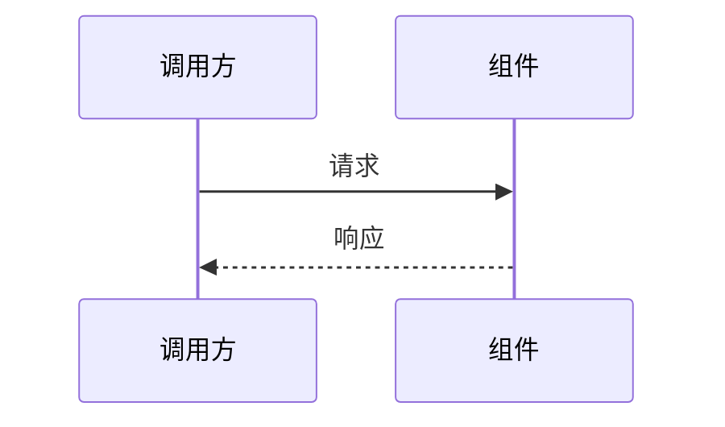

# 研发全流程

> **把系统做成什么样——需求文档回答；怎么实现——架构文档回答。**
> 基础约定（文档命名、反模式）参见 `development.instructions.md`。

适用于新建应用系统、新增功能模块、需求整理、架构设计等研发全流程任务。

---

## 1. 核心理念

```
一句话愿景 → 需求文档（WHAT）→ 功能清单（追踪+任务管理）→ 架构文档（HOW）→ 迭代开发 → 测试
```

- **需求文档 = WHAT**：定义系统长什么样、有哪些模块、每个模块做什么、不做什么、暂缓什么
- **架构文档 = HOW**：定义每个模块怎么实现——组件、流程、时序、关键决策
- **功能清单独立维护**：完成状态在 `功能清单.md` 追踪，不混入需求文档
- **大需求必须拆小**：功能点 > 5 / 实体 > 3 / 跨 2 层以上 → 先拆分再开发
- **竞品分析 = WHY NOT**：竞品分析报告是需求的第二来源，提供功能遴选依据，详见 [competitive-analysis](../competitive-analysis/SKILL.md) 技能
- **方案深度匹配问题复杂度**：简单需求用简单方案，复杂需求用完整架构。不要在简单 CRUD 上堆砌设计模式，也不要在复杂系统上走捷径
- **AI 是技术思考伙伴**：在需求整理和架构设计阶段，AI 主动提出不同方案对比，而非被动记录用户想法

---

## 2. 各阶段规范

### 2.1 需求整理（WHAT）

用户提供原始描述，AI 整理为 `Doc/需求文档.md`。需求文档只回答"系统做成什么样"，不涉及实现细节。

AI 在整理过程中承担**技术思考伙伴**角色：
- 先评估需求复杂度，确定需要多深度的方案
- 对模糊不清的需求点主动提问（"这里有几个选项..."、"是否需要考虑..."）
- 当用户表述带犹豫信号时，先做方案对比再写入文档
- 标注需要进一步确认的决策点

```markdown
# {项目名}需求文档

> 版本：v1.0 | 日期：{日期}

本文档描述 {项目名} 的愿景、核心目标和功能方向。完成状态在[功能清单](功能清单.md)中追踪，详细设计在[架构设计](架构设计.md)或各模块架构文档中展开。

## 1. 背景与愿景

### 1.1 系统定位
一句话说清楚这是什么系统、给谁用、解决什么问题。可以补充一个简表说明各产品/工程的定位差异。

### 1.2 愿景
系统做成了会是什么样子——越用越聪明、多入口统一服务、具备领域深度等。

## 2. 核心目标

先用一张表说清整体目标体系：

| 编号 | 目标 | 所属层级 | 一句话描述 |
|------|------|----------|------------|
| M1 | {目标名} | {层级} | {一句话} |
| M2 | {目标名} | {层级} | {一句话} |

## 3. 功能需求

按目标组织，每个目标下列出功能点。每个功能点一句话描述，不展开验收条件。

### 3.1 M1 {目标名}

- **M1-1 {功能名}**：一句话描述该功能做什么。
- **M1-2 {功能名}**：一句话描述。

### 3.2 M2 {目标名}

- **M2-1 {功能名}**：一句话描述。

...（其他目标）

## N. 🧊 暂缓清单

计划做但现在不做，注明显式理由和可重新评估的前提。

| 功能 | 暂缓理由 | 解冻前提 |
|------|----------|----------|
| {功能名} | {为什么现在不做} | {什么条件满足后可做} |

## N+1. 不做什么

明确排除的功能项，避免后续争议。

- {排除项}：{理由}
```

**规则**：
- 模块用 M1/M2/M3 编码，子功能用 M1-1/M1-2/M2-1 编码
- 核心目标表先总览后展开，功能需求按目标分组
- 每个子功能一句话描述，不展开验收条件、优先级、用户故事
- 非功能需求不单独列章（团队默认追求最高性能和安全）
- 不写术语表、边界与约束章节

### 2.2 功能清单（追踪）

独立文件 `Doc/功能清单.md`，维护每个子功能的完成状态，与需求文档中的模块编码一一对应。

```markdown
# {项目名}功能清单

> 版本：v1.0 | 日期：{日期}

> 状态标记：✅ 已实现 | 🟡 部分实现 | 🔧 规划中 | ⏸ 暂缓/占位 | ❌ 未开始

本清单维护"核心目标 → 功能模块/子模块 → 完成状态"。模块名优先对齐[需求文档](需求文档.md)第 3 章的功能点名称；需要更细设计时跳转到[架构设计](架构设计.md)或各模块架构文档。

## M1 {模块名}

| 编码 | 功能 | 状态 | 说明 |
|------|------|------|------|
| M1-1 | {子功能名} | ✅ | |
| M1-2 | {子功能名} | 🔧 | |
| M1-2a | {细分后的子子功能} | ✅ | 实现中进一步拆分 |

## M2 {模块名}

| 编码 | 功能 | 状态 | 说明 |
|------|------|------|------|
| M2-1 | {子功能名} | ❌ | |

## 统计

| 模块 | 功能数 | 已完成 | 完成率 |
|------|--------|--------|--------|
| M1 | 3 | 2 | 67% |
| M2 | 1 | 0 | 0% |
| **总计** | **4** | **2** | **50%** |
```

**规则**：
- 子功能在实现中可进一步拆分（如 M1-2 → M1-2a / M1-2b），用子编码追踪
- 统计表每模块一行 + 总计行，自动计算功能数与完成率
- 状态变更时同步更新，保持与代码实际进度一致
- 状态标记 `⏸` 表示暂缓或占位，与需求文档 🧊 暂缓清单对应

### 2.3 架构设计（HOW）

架构文档只回答"怎么实现"，不重复需求文档中的功能描述。

- **中小项目**：一份 `Doc/架构设计.md` 即可
- **大型项目**（功能点 > 5 / 实体 > 3 / 跨 2 层以上）：按模块拆分为 `Doc/M1-{模块名}.md`、`Doc/M2-3-{模块名}.md` 等

```markdown
# {项目名}架构设计

> 版本：v1.0 | 日期：{日期}
> 需求对应：[需求文档](需求文档.md) | 功能清单：[功能清单](功能清单.md)

## 1. 整体架构

分层/分模块总览（文字或 Mermaid），说明层间关系和核心设计原则。

## 2. M1 {模块名}

### 2.1 职责
一句话 + 职责表（| 职责 | 说明 |）

### 2.2 核心组件

| 组件 | 所在工程 | 说明 |
|------|----------|------|
| {类名/服务名} | {项目名} | 负责什么 |

### 2.3 关键流程



## 3. 设计决策

| 决策 | 选项 | 选择 | 理由 |
|------|------|------|------|
| {决策点} | A / B / C | A | {为什么} |
```

**大型项目拆分模板**（`Doc/M1-{模块名}.md`）：

```markdown
# M1-{模块名}

> 版本：v1.0 | 日期：{日期}
> 需求对应：[需求文档](需求文档.md) | 返回：[架构设计](架构设计.md)

## 1. 模块职责
...
## 2. 核心组件
...
## 3. 关键流程
...
## 4. 设计决策
...
```

**规则**：
- 架构文档的**核心组件表**必须包含"所在工程"列，标明每个组件的物理位置
- 关键流程用 Mermaid 时序图（`sequenceDiagram`）或流程图（`flowchart`）表达
- 设计决策表记录关键取舍（为什么选 A 不选 B），避免后人重蹈覆辙
- **决策深度匹配问题复杂度**：简单模块（1-2 实体）记录关键决策即可；复杂模块（>5 实体/跨服务）必须列出至少 2 个被否决的替代方案及其否决理由。AI 有义务主动提出被否决的选项
- 不写所有功能的细节，避免文档膨胀；子功能过于复杂时才单独加专项文档 `Doc/M1-{子功能名}-设计.md`
- 优先使用 NewLife 已有组件（XCode、Remoting、Stardust 等）；数据模型考虑 XCode 实体规范

### 2.4 竞品分析文档

> **定位**：竞品分析是需求的**第二来源**。先用内部视角（§2.1）拆出初版模块和功能列表（§2.2），形成项目骨架；再用竞品分析补充差距功能，避免"闭门造车"。

`Doc/竞品分析.md` 记录竞品功能对比与差距，是需求的第二来源。详细执行流程由 [competitive-analysis](../competitive-analysis/SKILL.md) 技能驱动。

```markdown
# {项目名}竞品分析

> 版本：v1.0 | 日期：{日期}

## 1. 概述
本报告对比 {项目名} 与市面上主流竞品，从功能覆盖、技术架构、许可等维度综合评估。

## 2. 竞品概览

| 项目 | 类型 | 语言/技术栈 | 许可证 | 最新版本 | GitHub Stars | 定位 |
|------|------|-----------|--------|---------|-------------|------|
| **{本项目}** | 开源/商用 | ... | MIT | ... | — | {一句话定位} |
| {竞品1} | 开源平台 | TypeScript + Python | Apache 2.0 | v1.0 | 100k | {定位} |

## 3. 功能对比矩阵

按能力域分组对比，使用统一标记：✅ 完整支持 | ⚠️ 部分可用 | ❌ 不支持

### 3.1 {能力域1}

| 功能 | 本项目 | 竞品1 | 竞品2 |
|------|:---:|:---:|:---:|
| {功能项} | ✅ | ✅ | ❌ |

### 3.2 {能力域2}
...

## 4. 结论与建议
- 本项目优势领域
- 差距领域与追赶优先级
```

**规则**：
- 竞品分析报告必须标注版本和日期，竞品数据需联网搜索验证，不凭记忆编造
- 功能矩阵按能力域分组建表，每张表用 ✅/⚠️/❌ 标记
- 竞品大版本发布后增量更新，不要全量重写
- 竞品分析中标记为不做的功能，同步到需求文档「不做什么」章节，避免重复评估

### 2.5 迭代开发

需求文档、功能清单、架构文档就绪后，按功能清单编码逐个推进：

```
认领功能编码 → 查阅架构文档 → 编码 → 编译通过 → 测试 → 继续下一功能
```

- 严格遵守编码规范，每个功能编译通过
- 编译失败 → 修复，不带着错误推进
- 有依赖按编码顺序执行，不跳跃
- 常规模式：遇歧义暂停确认；自治模式：检查点后批量处理
- 功能清单中状态同步更新（✅ 已完成）

### 2.6 测试

文档准备完成后跳过任务分解，直接在功能清单的编码粒度上进入迭代开发。每个功能项完成后须通过测试验证：

- **单元测试**：覆盖核心逻辑和边界条件
- **集成测试**：验证模块间交互和数据流
- **E2E 测试**：关键路径可用，可用于回归

**测试原则**：
- 先写测试再编码（TDD 可选，不做强制）
- 编译是底线，不通过不提交
- 每个批次结束时全量编译 + 关键路径冒烟

> 测试策略详情参见 `testing-strategy` 技能，强制测试规则参见 `development.instructions.md` §2.8。

### 2.7 竞品功能遴选规则

`Doc/竞品分析.md` 是需求的第二来源。从竞品分析中选择功能纳入需求文档和功能清单时，遵循以下规则：

**选取规则**（优先级从高到低）：

1. **愿景方向核心功能**：竞品有、本项目缺失，且属于项目愿景目标方向的功能 → 优先选取
2. **竞品普遍支持**：3 家以上竞品都支持，但本项目缺失 → 建议选取
3. **实现成本低收益高**：实现简单但能显著提升竞争力的功能 → 可选
4. **竞品独有亮点**：仅 1 家竞品支持但有独特价值的 → 评估后决定

**功能去向**：

| 决策 | 操作 | 记录位置 |
|------|------|---------|
| ✅ 确定做 | 加入需求文档对应模块章节 + 功能模块清单（状态 🔧） | 需求文档 + 功能清单 |
| ❌ 确定不做 | 记录到需求文档「不做什么」章节 | 需求文档末尾 |
| 🧊 延后做 | 记录到需求文档「暂缓清单」，标注理由和解冻前提 | 需求文档 🧊 暂缓清单 |

**防重复机制**（强制）：

- **选功能前**：必须先检查需求文档的「不做什么」和「🧊 暂缓清单」，已标记项不得再次选取
- **在竞品分析中标注**：确定不做或延后的功能，在竞品分析报告的对应功能行追加标注（如 `❌ [已评估不做]`、`🧊 [暂缓]`），避免后续阅读竞品分析时再次选中
- **解冻条件满足时**：暂缓清单中的功能在解冻前提满足后，可重新评估并移至功能清单

**流程**：

```
读取竞品分析报告 → 识别差距功能 → 检查「不做什么」+「暂缓清单」防重复
    → 选取候选功能 → 呈现给用户确认 → 加入需求文档 + 功能清单
```

---

## 3. AI 协作要点

### 3.1 阶段切换

| 用户说 | 进入阶段 |
|--------|----------|
| "整理需求"/"写需求" | §2.1 需求整理 |
| "竞品分析"/"对比竞品"/"行业调研" | 加载 `competitive-analysis` skill |
| "架构设计"/"怎么实现" | §2.3 架构设计 |
| "选功能"/"遴选功能"/"从竞品选功能" | §2.7 竞品功能遴选 |
| "开始开发"/"写代码"/"实现 M1-1" | §2.5 迭代开发 |
| "全部搞完"/"批量开发"/"自治模式"/"继续处理"/"接着做" | 第 4 节自治批处理 |
| 一大段描述未指定阶段 | 默认 §2.1 需求整理 |

### 3.2 主动引导

每阶段完成后提示下一步：需求整理完 → 功能清单？ → 架构设计？ → 开发？

### 3.3 大需求防护

功能点 > 5 / 实体 > 3 / 跨 2 层以上 / 描述 > 500 字 → 必须先拆分再开发。

---

## 4. 自治批处理模式

架构师已确认需求清单和架构方案后，AI 按任务清单自主执行。

### 4.1 进入条件

- [ ] 需求文档已完成且架构师已确认
- [ ] 关键模块的架构文档已完成且架构师已确认
- [ ] 功能清单已完成，子功能编码可作为最小追踪颗粒
- [ ] 用户明确触发（"全部搞完"/"批量开发"/"自治模式"等）

未满足时提示缺少哪些条件。

### 4.2 计划结构与循环刷新

```
1. [前置] 读取需求文档、功能清单与架构文档
2. [前置] 读取任务清单与进度状态
3. [前置] 全量编译确认基线
4. [批次1] 执行 M1-1, M1-2…
5. [检查点1] 输出批次1报告
6. [刷新] 重读需求文档与架构文档
7. [批次2] 执行 M1-3, M2-1…
8. [检查点2] 输出批次2报告
...（循环：刷新 → 批次 → 检查点）
N-1. [后置] 全量编译与测试
N.   [后置] 补完被跳过的功能
```

**要点**：
- 主步骤 15-25 个，刷新穿插在每两个批次之间对抗上下文漂移
- 无依赖的批次可合并执行，有依赖的必须顺序执行

### 4.3 执行协议

| 情况 | 处理方式 |
|------|----------|
| 功能明确无歧义 | 直接执行：编码 → 编译 → 测试 |
| 小歧义可合理推断 | 执行并在问题日志记录推断依据 |
| 重大歧义或多种等价方案 | 标记 `⏸️ 待确认`，跳过 |
| 前置功能被跳过 | 标记 `⏸️ 依赖阻塞：M1-x`，跳过 |
| 编译失败短时间无法修复 | 回滚改动，记录并跳过 |
| 涉及公共 API / 架构变更 | 标记 `⏸️ 需架构师决策`，兜底或跳过 |

### 4.4 检查点报告

```markdown
## 检查点 N 报告

### 完成情况
| 功能编码 | 状态 | 说明 |
|----------|------|------|
| M1-1 | ✅ 完成 | |
| M1-3 | ⏸️ 跳过 | 需确认：xxx |

### 编译状态
- 全量编译：✅ 通过 / ❌ 失败（错误详情）

### 问题日志
| 编号 | 类型 | 描述 | 影响功能 | 建议方案 |
|------|------|------|----------|----------|

### 统计
- 本批次 N 个，完成 X 个，跳过 Y 个
- 累计进度：已完成 X / 总计 Z（XX%）
```

### 4.5 用户回复与继续

架构师回来后：AI 呈现检查点报告 → 架构师批量回复问题 → AI 修正推断 + 执行跳过的功能 + 继续下批次。

触发词："继续"/"继续处理"/"回复完了"/"接着做"

### 4.6 质量护栏

- 编译门禁（失败即修复或回滚）
- 命名与架构方案一致
- 编码规范严格遵守
- 新增代码前搜索现有实现避免重复
- 不擅自引入新 NuGet 包

### 4.7 会话边界处理

每个检查点后、连续完成 15+ 功能项后 → 评估是否需要新会话。

**新会话续接模板**：

```
我们在做 {项目名} 的自治批处理开发。
- 需求文档：Doc/需求文档.md
- 功能清单：Doc/功能模块清单.md
- 架构文档：Doc/M1-{模块名}.md（及其他模块）
- 当前进度：批次 N 已完成，从批次 N+1 的 M1-x 开始继续
- 待解决问题：{问题编号}
请读取以上文档，从 M1-x 继续执行，自治模式。
```

### 4.8 批次大小建议

| 复杂度 | 批次大小 |
|--------|---------|
| 简单（CRUD） | 8-10 |
| 中等（业务逻辑） | 5-7 |
| 复杂（算法、并发） | 3-5 |

单会话上限：3-4 个批次（约 15-25 个任务）。
